# Landmark Recognition Using the SIFT Algorithm

**Course:** Computer Vision | **Roll No:** FA23-BAI-029
**Tools:** Python, OpenCV (v4.14.0), NumPy, Pandas, Matplotlib

This project recognizes landmarks with SIFT features, Brute-Force matching with KNN (k=2) and Lowe's ratio test, and RANSAC homography for geometric verification and localization. All results below are the actual outputs of the notebook `LAB_ASSIGNMENT_FA23_BAI_029_CV.ipynb`.

---

## Parameters

| Parameter | Value | Meaning |
|---|---|---|
| `MAX_DIM` | 800 | Resize large images for speed |
| `RATIO` | 0.75 | Lowe's ratio threshold |
| `MIN_GOOD` | 15 | Minimum reliable matches to consider a landmark |
| `MIN_INLIERS` | 12 | Minimum RANSAC inliers |
| `MIN_INLIER_RATIO` | 0.25 | Inliers / reliable matches |
| `MARGIN` | 1.5 | Best landmark needs ≥ 1.5× inliers of the runner-up |
| `RANSAC_THRESH` | 5.0 px | RANSAC reprojection threshold |

---

## Task 1 – Landmark Image Database

Images were downloaded from Wikimedia Commons (5 landmarks, plus 1 unknown landmark held out for rejection tests).

```
DATABASE STRUCTURE
  Eiffel_Tower           4 images   [wikimedia]
  Taj_Mahal              4 images   [wikimedia]
  Colosseum              4 images   [wikimedia]
  Statue_of_Liberty      3 images   [wikimedia]
  Great_Wall_of_China    4 images   [wikimedia]
  (unknown test landmark: Pyramids_of_Giza [wikimedia] - not in database)
```

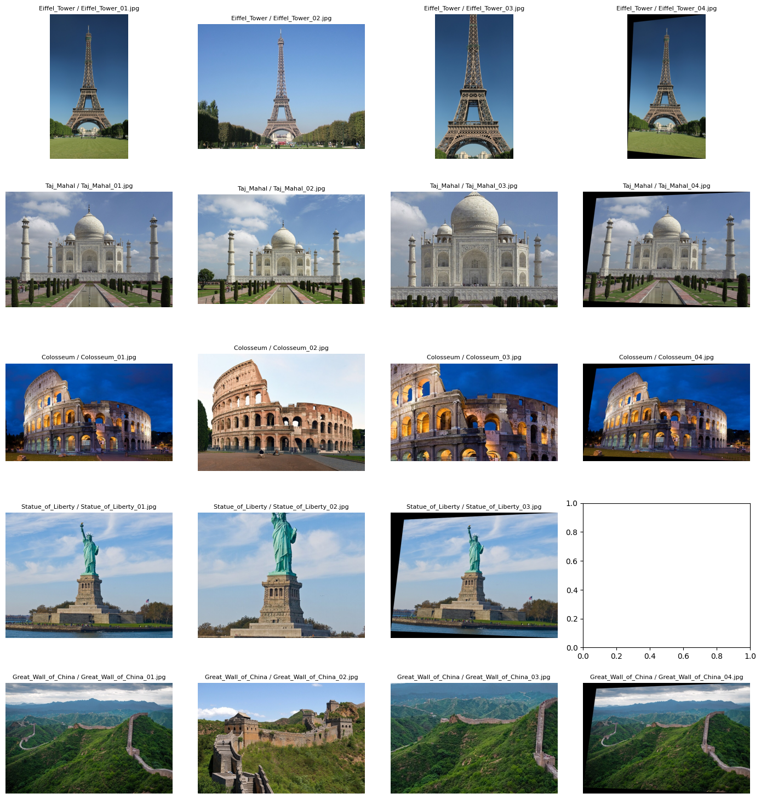

---

## Task 2 – SIFT Feature Extraction (Reference Images)

Each image is converted to grayscale, then SIFT keypoints and 128-D descriptors are extracted and saved to `sift_database.pkl`.

| # | Landmark | Image | Keypoints | Descriptor shape |
|---|---|---|---|---|
| 0 | Eiffel_Tower | Eiffel_Tower_01.jpg | 1201 | (1201, 128) |
| 1 | Eiffel_Tower | Eiffel_Tower_02.jpg | 1523 | (1523, 128) |
| 2 | Eiffel_Tower | Eiffel_Tower_03.jpg | 3662 | (3662, 128) |
| 3 | Eiffel_Tower | Eiffel_Tower_04.jpg | 1533 | (1533, 128) |
| 4 | Taj_Mahal | Taj_Mahal_01.jpg | 1753 | (1753, 128) |
| 5 | Taj_Mahal | Taj_Mahal_02.jpg | 1660 | (1660, 128) |
| 6 | Taj_Mahal | Taj_Mahal_03.jpg | 4754 | (4754, 128) |
| 7 | Taj_Mahal | Taj_Mahal_04.jpg | 2060 | (2060, 128) |
| 8 | Colosseum | Colosseum_01.jpg | 2235 | (2235, 128) |
| 9 | Colosseum | Colosseum_02.jpg | 2986 | (2986, 128) |
| 10 | Colosseum | Colosseum_03.jpg | 5062 | (5062, 128) |
| 11 | Colosseum | Colosseum_04.jpg | 2338 | (2338, 128) |
| 12 | Statue_of_Liberty | Statue_of_Liberty_01.jpg | 1274 | (1274, 128) |
| 13 | Statue_of_Liberty | Statue_of_Liberty_02.jpg | 2392 | (2392, 128) |
| 14 | Statue_of_Liberty | Statue_of_Liberty_03.jpg | 1476 | (1476, 128) |
| 15 | Great_Wall_of_China | Great_Wall_of_China_01.jpg | 2737 | (2737, 128) |
| 16 | Great_Wall_of_China | Great_Wall_of_China_02.jpg | 2941 | (2941, 128) |
| 17 | Great_Wall_of_China | Great_Wall_of_China_03.jpg | 7884 | (7884, 128) |
| 18 | Great_Wall_of_China | Great_Wall_of_China_04.jpg | 2894 | (2894, 128) |

**Total reference images:** 19

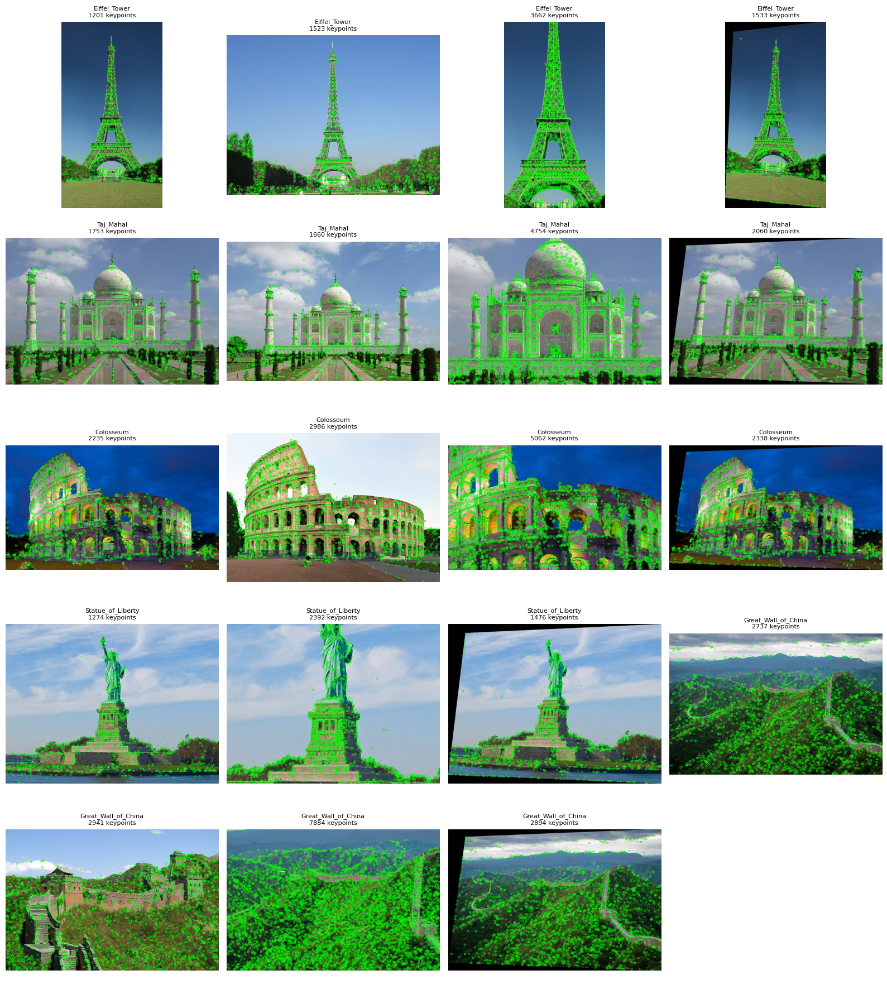

---

## Task 3 – Query Image Processing

A query image is resized, converted to grayscale, and SIFT features are extracted. Demo query (Eiffel Tower): **1527 keypoints**, descriptor matrix shape **(1527, 128)**.

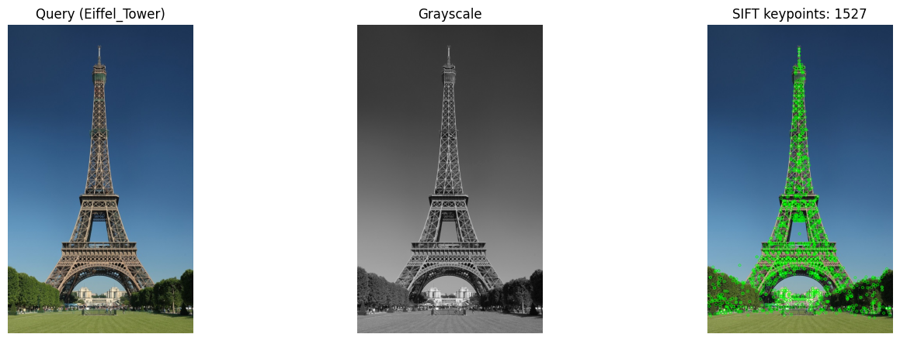

---

## Task 4 & 5 – Matching, Recognition and Localization

Pipeline: BF matcher (L2) → KNN k=2 → Lowe's ratio test → RANSAC homography → polygon sanity checks → margin test against the runner-up.

### Demo 1 – Known landmark (Eiffel Tower) → RECOGNIZED

| Rank | Landmark | Reliable matches | RANSAC inliers | Valid geometry |
|---|---|---|---|---|
| 1 | Eiffel_Tower | 736 | 696 | True |
| 2 | Taj_Mahal | 7 | 0 | False |
| 3 | Colosseum | 7 | 0 | False |
| 4 | Statue_of_Liberty | 7 | 0 | False |
| 5 | Great_Wall_of_China | 4 | 0 | False |

**Decision:** RECOGNIZED (passed match threshold, RANSAC and margin tests)
**Predicted:** Eiffel_Tower | Reliable matches: 736 | Inliers: 696

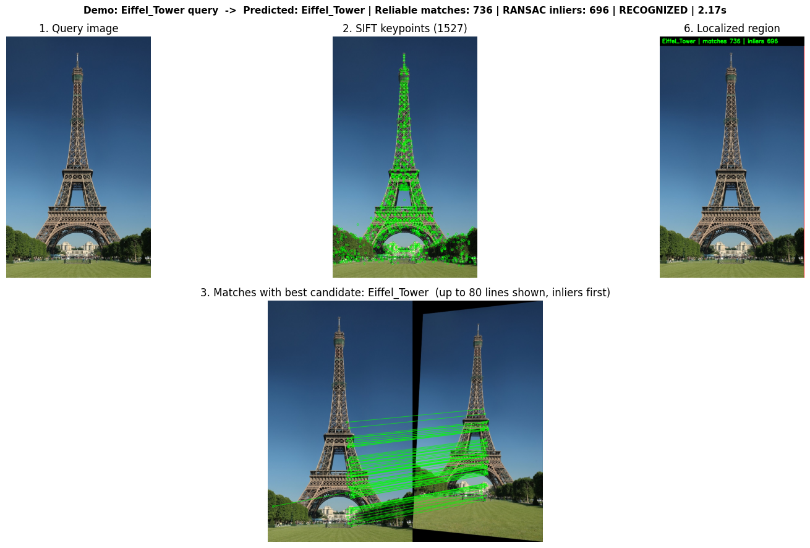

### Demo 2 – Unknown landmark (Pyramids of Giza, not in DB) → REJECTED

| Rank | Landmark | Reliable matches | RANSAC inliers | Valid geometry |
|---|---|---|---|---|
| 1 | Statue_of_Liberty | 7 | 0 | False |
| 2 | Eiffel_Tower | 6 | 0 | False |
| 3 | Colosseum | 5 | 0 | False |
| 4 | Taj_Mahal | 4 | 0 | False |
| 5 | Great_Wall_of_China | 3 | 0 | False |

**Decision:** REJECTED (only 7 reliable matches, below 15)
**Predicted:** Unknown | Reliable matches: 7 | Inliers: 0
**Message:** Landmark rejected / geometric transformation unreliable – no polygon drawn.

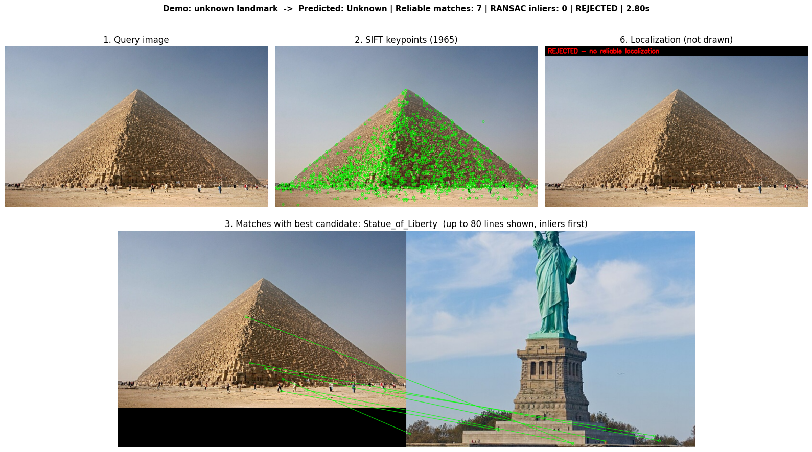

---

## Task 6 – Performance Evaluation

Each landmark was tested under five conditions: original, rotated (30°), resized (50%), reduced brightness, and different viewpoint. The unknown landmark was tested separately (correct behaviour = Rejected).

| Query (true landmark) | Condition | Predicted | Keypoints | Reliable matches | RANSAC inliers | Decision | Correct | Time (s) |
|---|---|---|---|---|---|---|---|---|
| Eiffel_Tower | Original | Eiffel_Tower | 1527 | 736 | 696 | Recognized | Yes | 2.150 |
| Eiffel_Tower | Rotated (30 deg) | Eiffel_Tower | 1761 | 838 | 773 | Recognized | Yes | 2.510 |
| Eiffel_Tower | Resized (50%) | Eiffel_Tower | 375 | 244 | 232 | Recognized | Yes | 0.528 |
| Eiffel_Tower | Reduced brightness | Eiffel_Tower | 958 | 476 | 442 | Recognized | Yes | 1.366 |
| Eiffel_Tower | Different viewpoint | Eiffel_Tower | 1539 | 807 | 750 | Recognized | Yes | 2.285 |
| Taj_Mahal | Original | Unknown | 2862 | 69 | 11 | Rejected | No | 4.131 |
| Taj_Mahal | Rotated (30 deg) | Unknown | 2996 | 83 | 8 | Rejected | No | 4.344 |
| Taj_Mahal | Resized (50%) | Unknown | 776 | 12 | 4 | Rejected | No | 1.144 |
| Taj_Mahal | Reduced brightness | Unknown | 1094 | 28 | 7 | Rejected | No | 1.747 |
| Taj_Mahal | Different viewpoint | Unknown | 2718 | 44 | 7 | Rejected | No | 3.969 |
| Colosseum | Original | Colosseum | 2632 | 76 | 43 | Recognized | Yes | 3.877 |
| Colosseum | Rotated (30 deg) | Colosseum | 2302 | 48 | 27 | Recognized | Yes | 3.397 |
| Colosseum | Resized (50%) | Colosseum | 750 | 24 | 20 | Recognized | Yes | 1.036 |
| Colosseum | Reduced brightness | Colosseum | 625 | 26 | 15 | Recognized | Yes | 0.927 |
| Colosseum | Different viewpoint | Colosseum | 2121 | 48 | 24 | Recognized | Yes | 3.083 |
| Statue_of_Liberty | Original | Statue_of_Liberty | 1237 | 107 | 79 | Recognized | Yes | 1.901 |
| Statue_of_Liberty | Rotated (30 deg) | Statue_of_Liberty | 1349 | 120 | 92 | Recognized | Yes | 2.140 |
| Statue_of_Liberty | Resized (50%) | Statue_of_Liberty | 452 | 45 | 36 | Recognized | Yes | 0.664 |
| Statue_of_Liberty | Reduced brightness | Statue_of_Liberty | 301 | 25 | 13 | Recognized | Yes | 0.516 |
| Statue_of_Liberty | Different viewpoint | Statue_of_Liberty | 1249 | 123 | 89 | Recognized | Yes | 1.933 |
| Great_Wall_of_China | Original | Unknown | 3454 | 26 | 6 | Rejected | No | 4.828 |
| Great_Wall_of_China | Rotated (30 deg) | Unknown | 3838 | 47 | 5 | Rejected | No | 5.515 |
| Great_Wall_of_China | Resized (50%) | Unknown | 812 | 12 | 5 | Rejected | No | 1.123 |
| Great_Wall_of_China | Reduced brightness | Unknown | 540 | 11 | 5 | Rejected | No | 0.912 |
| Great_Wall_of_China | Different viewpoint | Unknown | 3530 | 32 | 5 | Rejected | No | 5.111 |
| Pyramids_of_Giza (not in DB) | Unknown - original | Unknown | 1965 | 7 | 0 | Rejected | Yes | 2.705 |
| Pyramids_of_Giza (not in DB) | Unknown - resized 50% | Unknown | 308 | 4 | 0 | Rejected | Yes | 0.439 |

### Summary

- **Overall correct decisions:** 17/27 (**63.0%**)
- **Average processing time:** 2.381 s per query

| Condition | Correct |
|---|---|
| Original | 3/5 |
| Rotated (30°) | 3/5 |
| Resized (50%) | 3/5 |
| Reduced brightness | 3/5 |
| Different viewpoint | 3/5 |
| Unknown – original | 1/1 |
| Unknown – resized 50% | 1/1 |

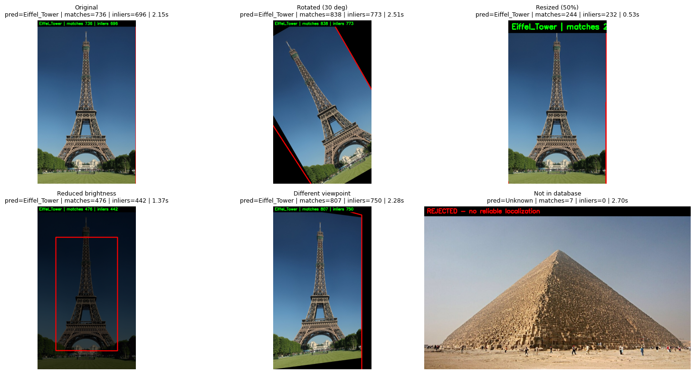

### Detailed result screens (Eiffel Tower, per condition)

| Condition | Result | Reliable matches | Inliers |
|---|---|---|---|
| Original | RECOGNIZED – Eiffel_Tower | 736 | 696 |
| Rotated (30°) | RECOGNIZED – Eiffel_Tower | 838 | 773 |
| Resized (50%) | RECOGNIZED – Eiffel_Tower | 244 | 232 |
| Reduced brightness | RECOGNIZED – Eiffel_Tower | 476 | 442 |
| Different viewpoint | RECOGNIZED – Eiffel_Tower | 807 | 750 |
| Unknown landmark | REJECTED – Unknown | 7 | 0 |


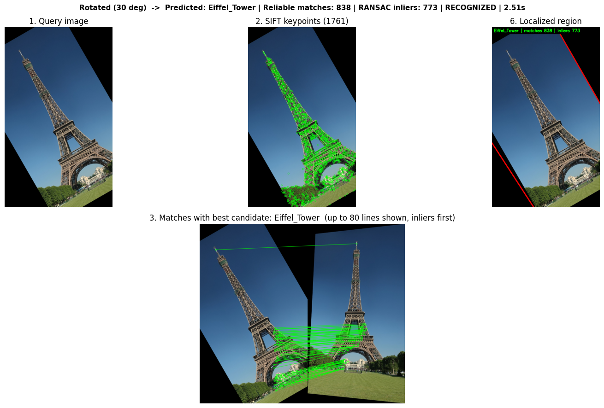
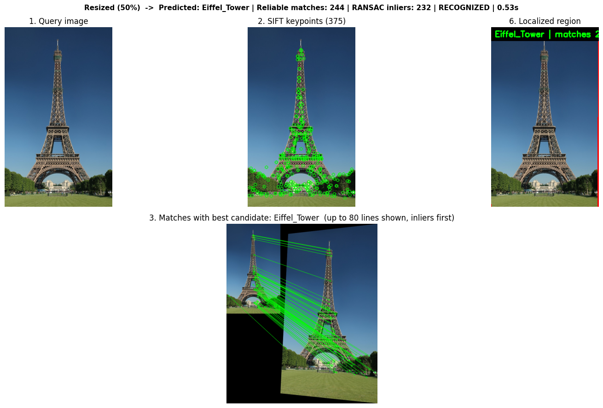
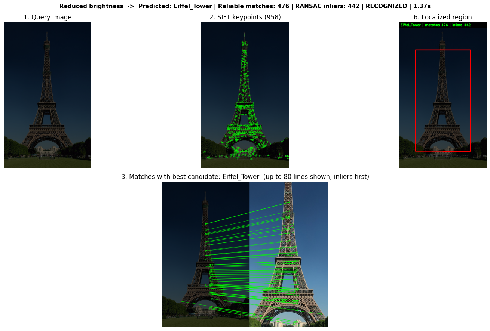
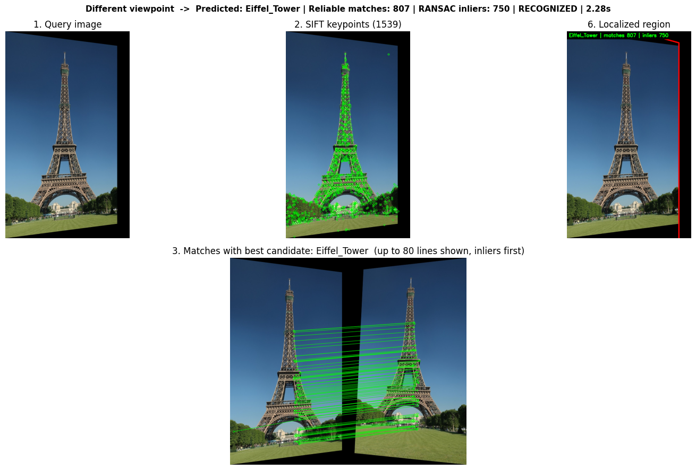
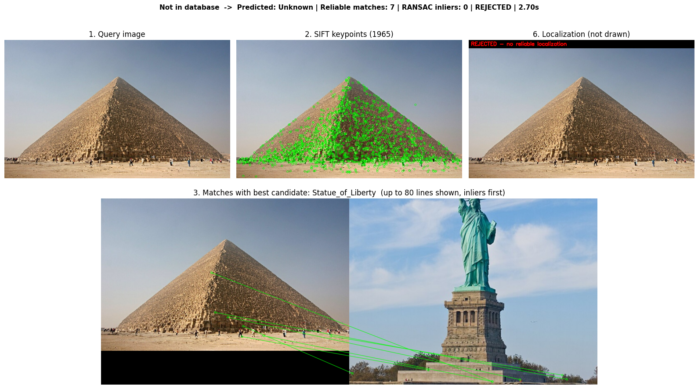

---

## Test With Your Own Image

An uploaded image (`images.jpg`) was tested against the database:

| Rank | Landmark | Reliable matches | RANSAC inliers | Valid geometry |
|---|---|---|---|---|
| 1 | Statue_of_Liberty | 13 | 9 | False |
| 2 | Eiffel_Tower | 9 | 6 | False |
| 3 | Great_Wall_of_China | 4 | 0 | False |
| 4 | Taj_Mahal | 3 | 0 | False |
| 5 | Colosseum | 2 | 0 | False |

**Decision:** REJECTED (only 13 reliable matches, below 15) | **Predicted:** Unknown

| File | Predicted | Keypoints | Reliable matches | RANSAC inliers | Decision | Time (s) |
|---|---|---|---|---|---|---|
| images.jpg | Unknown | 164 | 13 | 9 | Rejected | 0.255 |

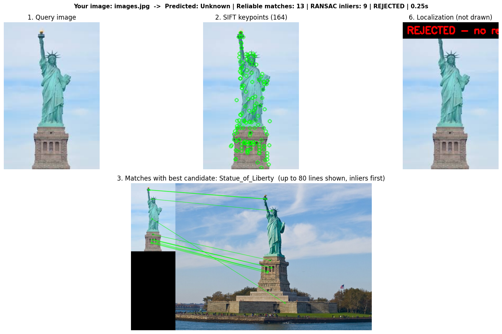

---

## Discussion of Performance and Limitations

**Performance.** SIFT keypoints are invariant to scale and rotation and partially invariant to illumination. For the Eiffel Tower, Colosseum and Statue of Liberty, every condition (original, rotated, resized, darkened, new viewpoint) was recognized correctly with a large RANSAC inlier set, and the projected polygon followed the landmark's position, size and orientation. A decision is accepted only if (a) enough reliable matches exist, (b) the RANSAC homography has enough inliers with an acceptable inlier ratio and a valid convex polygon, and (c) the best landmark clearly beats the runner-up, so the largest match count alone never decides the label. The Pyramids of Giza (not in the database) were correctly rejected in both tests.

**Failures observed.** Taj Mahal and Great Wall of China were rejected in all 5 conditions each (10 of the 10 wrong decisions). Their inlier counts (4–11) fell below `MIN_INLIERS = 12` even though some had many reliable matches (e.g. 69 and 83 for Taj Mahal). This is consistent with the limitations below: the Taj Mahal's symmetric, low-texture marble surfaces and the Great Wall's repetitive brick pattern produce ambiguous matches that do not fit a single consistent homography. Because the same two landmarks fail in every condition, the cause is the landmark and reference images rather than the transformation. The uploaded test image was also rejected, with only 164 keypoints.

**Limitations.**
- Strong viewpoint changes (large perspective/3-D change) reduce the number of matches; a planar homography is only an approximation for 3-D buildings.
- Very dark / low-contrast images give fewer keypoints.
- Repetitive structures (Colosseum arches, Great Wall bricks) can create ambiguous matches.
- Brute-force matching is O(N·M); a large database would need FLANN / indexing.
- Accuracy depends on the number and variety of reference images; thresholds (`RATIO`, `MIN_GOOD`, `MIN_INLIERS`) may need tuning.
- The strict thresholds favour rejecting uncertain queries, which gave correct rejections of the unknown landmark but also false rejections of known ones (overall 63.0%).

---

## Project Files

- `LAB_ASSIGNMENT_FA23_BAI_029_CV.ipynb` – full notebook
- `sift_database.pkl` – saved descriptors and labels (generated when the notebook runs)
- `images/` – figures exported from the notebook outputs
